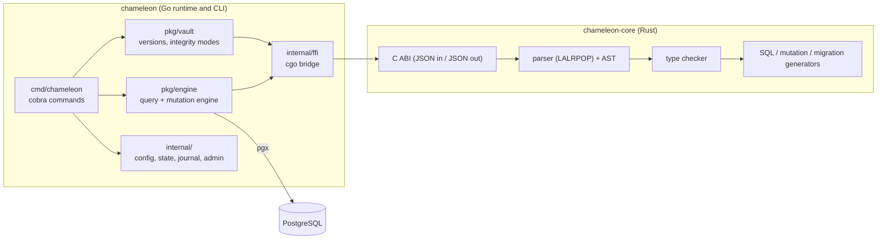
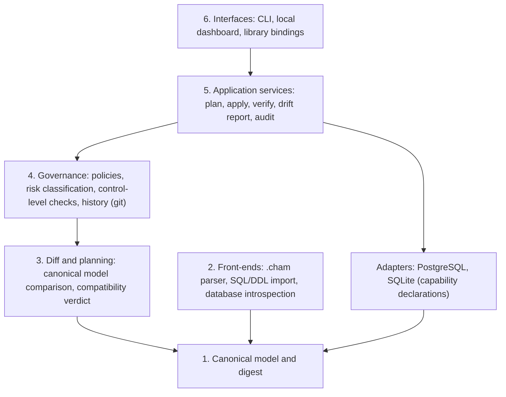

# Architecture overview

> **Status:** draft · **Date:** 2026-10-24
> Part 1 describes the code as reviewed on 2026-10-23. Part 2 is the **proposed target** and is not implemented. Keep the two separate ([ADR-0002](../adr/0002-honest-claims-policy.md)).

## Part 1 — Current architecture

### Shape

A monorepo with two programs joined by a native boundary:

### Components

| Component | Responsibility | Language |
|---|---|---|
| Parser and AST | Read `.cham` schema files into a typed tree | Rust |
| Type checker | Validate entities, fields, relations and annotations | Rust |
| SQL generator | Produce SQL for queries from a query description | Rust |
| Mutation generator | Produce SQL for inserts, updates and deletes. **Not used at runtime**; the Go implementation is the real path | Rust |
| Migration generator | Produce DDL from a schema | Rust |
| C ABI | Expose the above to other languages as JSON-in / JSON-out functions | Rust |
| FFI bridge | Call the C ABI through cgo | Go |
| Engine | Build queries, execute them, run mutations with write guards, map results | Go |
| Connector | PostgreSQL connection pool (pgx) | Go |
| Vault | Store schema versions under `.chameleon/vault`, hash them (SHA-256 of the schema text), enforce integrity modes (readonly, standard, privileged, emergency), keep an integrity log | Go |
| Journal and state | Local record of operations and migration state | Go |
| Introspection | Generate a schema from an existing PostgreSQL database | Go |
| CLI | User-facing commands ([reference](../cli-reference.md)) | Go |
| Dashboard and playground | Local HTTP servers for a dashboard API and SQL compilation experiments | Go |

### Main flows

**Check a schema.** `chameleon check|validate file.cham` → Go reads the file → FFI → Rust parses and type-checks → diagnostics returned as JSON → printed.

**Migrate.** `chameleon migrate` → schema is parsed and checked → migration DDL generated in Rust → vault registers the schema version (hash, mode check) → DDL executed through pgx → journal and migration state updated.

**Query.** Application code uses the engine API (`Filter`, `Include`, `OrderBy`, …) → query description serialised to JSON → Rust generates SQL → Go executes it through the connection pool → rows are mapped to results.

**Mutate.** Engine mutation builders create SQL with positional parameters in Go and execute it through pgx; updates and deletes without filters are blocked by the builders. Documentation mentions explicit bypass methods (`ForceUpdateAll`, `ForceDeleteAll`) that do not exist in the code.

**Vault and modes.** The mode (stored in `.chameleon/vault`) decides which operations are allowed; changing to a higher privilege needs the configured password; every transition is recorded in the integrity log.

### Known limitations of the current design

These are the facts the redesign must address; details of security findings are tracked privately.

- Two languages joined by cgo make building and installing harder ([ADR-0011](../adr/0011-language-runtime-and-distribution.md)).
- Behaviour is duplicated in Rust and Go for mutations.
- Generated SQL is not guaranteed to be deterministic.
- The schema hash is computed over the source text, not over a canonical form ([ADR-0005](../adr/0005-canonical-schema-digest.md)).
- The vault is a set of local files; its integrity checks detect accidental or unexpected change, not a privileged user who edits files and hashes.
- Only PostgreSQL is supported, and introspection covers a subset of objects.
- Several documents describe capabilities beyond what the code does; they are being corrected.

## Part 2 — Target architecture (proposed)

Derived from [the vision](../vision-and-foundations.md) and ADRs 0004–0011. Everything here is subject to validation.

### Principles

1. **A modular monolith in one repository.** One product, one release, clear internal boundaries. No services until there is a reason.
2. **Layers with one-way dependencies.** A layer knows only the layers below it.
3. **A single canonical model** is the source of truth for digest, planning, drift and compatibility ([ADR-0005](../adr/0005-canonical-schema-digest.md), [ADR-0008](../adr/0008-schema-source-dsl-vs-sql-first.md)).
4. **Engines behind adapters** that declare their capabilities ([ADR-0010](../adr/0010-backend-strategy-and-capability-declarations.md)).
5. **Honest levels of control**: observe, mediated, enforced through database roles ([ADR-0006](../adr/0006-levels-of-control-and-role-enforcement.md)).
6. **Stable, versioned boundaries** for anything another language or process consumes.

### Layers

| Layer | Responsibility |
|---|---|
| 1. Canonical model and digest | Engine-neutral representation of a schema; deterministic canonical form and `schema_digest` |
| 2. Front-ends | Produce the canonical model from `.cham`, from SQL/DDL, or from a live database |
| 3. Diff and planning | Compare two models, classify changes (additive, requires translation, destructive, locking), produce plans |
| 4. Governance | Policies, risk gates, control-level verification, history of revisions and proposals |
| 5. Application services | Use cases: `plan`, `apply`, `verify`, `drift`, `audit` |
| 6. Interfaces | CLI, optional dashboard, bindings |
| Adapters | Connect to an engine, introspect it, execute plans, declare capabilities |

### Delta from today

| Area | Today | Target |
|---|---|---|
| Schema identity | SHA-256 of source text | Canonical digest |
| Source languages | `.cham` | `.cham` plus SQL import and introspection into one model |
| Backends | PostgreSQL | PostgreSQL and SQLite behind adapters |
| Control | Local modes, password | Levels of control verified against database roles |
| History | Vault files | Git-based history with lifecycle states on references (proposed) |
| Drift | Not classified | Observed and classified |
| Boundary | cgo, JSON | To be decided ([ADR-0011](../adr/0011-language-runtime-and-distribution.md)) |

### Not in scope for the first horizons

Sync engines, compliance features, hosted services, additional engines beyond the first pair.
